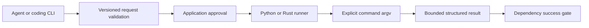
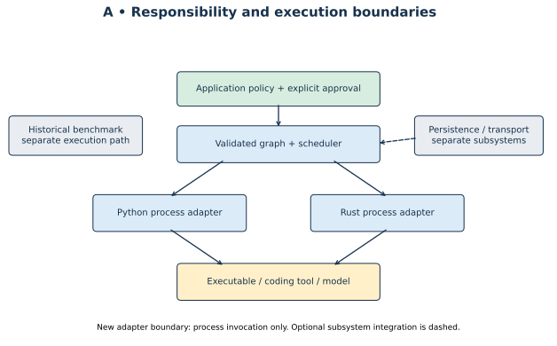

# DAF Python

Portable command execution and explicit dependency workflows for Darshj's Agent Framework, by Darshankumar Joshi. This independent Python implementation shares the version 1 command-adapter contract with [DAF Rust](https://github.com/darshjme/daf). It requires Python 3.10+ and has no runtime dependencies.

```sh
python -m pip install .
daf-adapter-py capabilities
daf-adapter-py run request.json
```

```json
{"schema_version":1,"id":"inspect","argv":["git","status","--short"],"timeout_ms":30000,"max_output_bytes":65536}
```

The runner passes argv directly to the operating system, captures stdout and stderr separately, drains both streams, bounds retained bytes and enforces a deadline. Results carry request identity, status, exit code and truncation flags. Invalid requests exit 2; successful commands exit 0; command failures and timeouts exit 1. A JSON request file does not change the command's working-directory base.

## Python and DJCODE integration

```python
from daf_adapter import run, execute_workflow

async def approval(request):
    return await application_approval(request)  # Your UI/policy must decide.

results = await execute_workflow([
    {"request": {"schema_version": 1, "id": "inspect",
                 "argv": ["git", "status", "--short"]}},
], approval, concurrency=2)
```

For DJCODE, `djcode.adapter_workflow.execute_adapter_workflow` accepts DJCODE nodes named `daf_adapter_run`, an approval callback `(name, request)`, and this package's `run` callback. That bridge retains DJCODE's real Rust DAF/DDAL scheduler. Its acceptance tests exercise real transport; this package's own DAG scheduler is a separate Python execution path and does not claim DDAL framing or Rust storage parity.



## Execution boundary

Any CLI that supports noninteractive argv and optional text stdin can be configured through this contract. Interactive TTY-only tools require a separate adapter. Named model providers are not automatically authenticated or tested. The runner inherits the environment and filesystem authority of its caller: it is not a sandbox. It kills and reaps its direct child on timeout/cancellation; independently surviving descendants require host containment. Commands are never automatically retried. A successful process exit does not prove semantic correctness of generated code.

The Python workflow layer validates the entire DAG before approval or execution, runs dependency waves with bounded concurrency, and marks descendants skipped after failure or denial. It does not persist or replay results, and it does not replicate the Rust vault, durable ledger, graph conditionals or network services.

## Verify

```sh
PYTHONPATH=src python -m unittest discover -s tests -v
python -m build
```

Verification runs locally. GitHub Actions is not used. See [protocol details](docs/PROTOCOL.md), the [original paper](https://doi.org/10.5281/zenodo.23755123), and [author Instagram](https://www.instagram.com/darshjme/).


